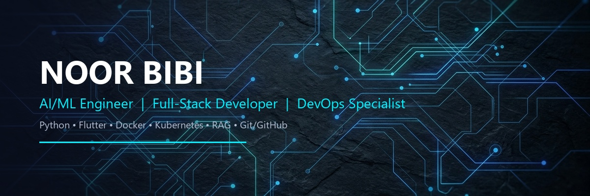

  

  

  <h2>Hi, I'm Noor Bibi</h2>
  
<strong>AI/ML Engineer & Full Stack Developer</strong>

  
Lahore, Pakistan

  
  
  

---

## About

I'm a Computer Science graduate and Full Stack Developer specializing in AI/ML engineering, FastAPI backends, and Retrieval-Augmented Generation (RAG) systems, with a strong foundation in relational databases (MySQL, PostgreSQL). I build end-to-end web applications, evidence-backed clinical knowledge systems, and cross-platform Flutter mobile apps. I also bring experience in university teaching and technical leadership.

---

## Tech Stack

**AI / ML:** RAG · ChromaDB · XGBoost · Random Forest · Computer Vision · LLM Validation

**Backend & Web:** Python · FastAPI · Node.js · Express.js · React.js · JavaScript · HTML5 · CSS3 · REST APIs · JWT

**Mobile:** Flutter · Dart

**Databases:** MySQL · PostgreSQL · Firebase · SQL · ChromaDB

**DevOps & Tools:** Docker · Kubernetes · GitHub Actions · Git · Vercel

  
  
  
  
  
  
  
  
  
  
  
  
  
  

---

## Featured Projects

### [MedAssist: RAG Clinical Knowledge Assistant](https://github.com/noor-bibi-bi/medassist-rag)
A clinical assistant that delivers evidence-backed medical responses using Retrieval-Augmented Generation. **[Live demo](https://medassist-rag-two.vercel.app/)**
- Dual-layer hallucination mitigation: semantic retrieval filtering plus LLM relevance validation.
- 25/25 on a 25-question eval set across five medical categories. Known limitation: can still overfit on some responses.
- **Stack:** Python, FastAPI, ChromaDB, RAG, Vercel

### [SmogSense: AI Air Quality Forecasting for Lahore](https://github.com/noor-bibi-bi/SmogSense)
An air quality forecasting and morning school-activity alert system built for the Smart City Hackathon. **[Live demo](https://smog-sense.vercel.app/)**
- Dual XGBoost model: a classifier for recess advisories and a regressor for 7-day PM2.5 trends.
- Combines OpenAQ sensor measurements with Open-Meteo forecasts, with an out-of-time winter validation window.
- FastAPI backend with automated morning email alerts for schools.
- **Stack:** Python, FastAPI, XGBoost, OpenAQ API, Open-Meteo, Vercel

### [AquaGuard: AI-Powered Safe Water Quality Prediction](https://github.com/noor-bibi-bi/AquaGuard)
A machine learning pipeline that predicts ground and lake water safety from chemical quality thresholds.
- Compared Random Forest and XGBoost classifiers for water potability prediction.
- Labeled safety levels using WHO and IS water safety standards on combined environmental datasets.
- Built interactive Folium geospatial dashboards (heatmaps and marked safety locations) exported as standalone HTML.
- **Stack:** Python, Random Forest, XGBoost, Folium

### Atelier: AI-Based Personal Styling Application *(Final Year Project)*
A cross-platform Flutter app that generates personalized styling recommendations using computer vision.
- Trained a 12-season machine learning model to identify color palettes from user selfies.
- FastAPI backend for wardrobe management, outfit planning, and personalized recommendations.
- **Stack:** Flutter, Dart, FastAPI, Python, Computer Vision, Machine Learning

### [DevOpsFlow: Containerized CI/CD Platform](https://github.com/noor-bibi-bi/devopsflow-Project)
A three-tier platform focused on CI/CD automation and container orchestration.
- Three-tier architecture with React, Express, and PostgreSQL.
- GitHub Actions pipeline covering unit testing, vulnerability scanning, Docker builds, and Kubernetes deployment.
- **Stack:** React, Express, PostgreSQL, Docker, Kubernetes, GitHub Actions

---

## Experience

- **Instructor**, RISE (Jul 2025 – Present): teaching digital skills and problem-solving to cohorts of 11–15 students.
- **President**, BNU SciTech Society (May 2025 – Jun 2026): led hackathons, workshops, seminars, and industry networking events.
- **Teaching Assistant**, Beaconhouse National University (Sep 2024 – May 2025): DBMS, ADBMS, and AI; mentored 60+ students.
- **Frontend Developer (Freelance)**, Bytecode Technologies (2023 – 2024).
- **Freelance Developer & Digital Specialist** (Mar 2021 – Present): full-stack, frontend, and Flutter projects via Fiverr, Upwork, and direct clients; Shopify store maintenance and social media management.

## Education

**BS in Computer Science**, Beaconhouse National University, Lahore (Sep 2022 – Jun 2026)

## Certifications

- Ethical Hacking Fundamentals, LearnKartS
- APAC Solution Challenge, GDGoC Beaconhouse National University
- SOFTEC, FAST National University (FAST NUCES)
